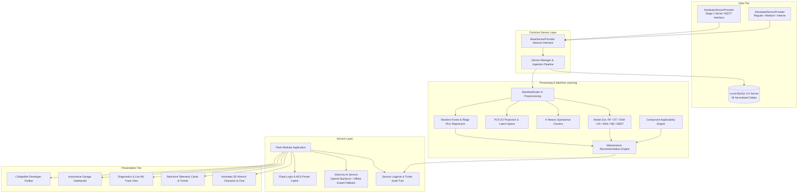

# POCKET MECHANIC — System Architecture Document
### Stage 1: Software-Only Predictive Motorcycle Diagnostics Platform

---

## 1. Executive Architectural Overview

**Pocket Mechanic** is an automotive-grade motorcycle diagnostic and predictive maintenance platform built using a local offline architecture. It operates entirely on-laptop without mandatory cloud dependencies.

---

## 2. Decoupled Sensor Ingestion Architecture

A critical non-negotiable architectural requirement is the clean separation of sensor generation from predictive machine learning:

1. **`BaseSensorProvider` (Abstract Base Class)**:
   - Exposes `get_telemetry_packet(motorcycle_id, variant_specs, intensity)` returning a standardized schema.
   - Enforces `source_type` labeling (`SIMULATED` vs `HARDWARE`).
   - Declares `get_provider_status() -> dict` and `is_hardware() -> bool`.

2. **Stage 1 Implementation — `SimulatedSensorProvider`**:
   - Generates correlated physics-based signals: engine thermal dynamics, RPM-speed kinematics, alternator charging voltage, rotational vibration harmonics, tyre pressure heat expansion, brake pad wear, and chain slack.
   - Modulated by 3 selectable intensities:
     - **Regular**: Healthy, nominal operating profile.
     - **Medium**: Elevated thermal stress, slight charging voltage dip, and moderate mechanical vibration.
     - **Intense**: Severe failure states (engine overheating > 120°C, diode collapse < 11.5V, pad thinning < 1.5mm, loose jumping chain > 45mm).

3. **Stage 2 Future-Ready Implementation — `HardwareSensorProvider`**:
   - Connects to physical ESP32 DAQ microcontroller via USB Serial (`/dev/tty.usbserial*`) or MQTT bus.
   - **Strict Data Integrity Rule**: When physical hardware is offline, returns `connected=False` and **NO fabricated data** (`readings=None`).

---

## 3. Component Applicability Engine

Different motorcycle architectures must not display universal maintenance checklists:
- **Cooling Type**: Air-cooled motorcycles (e.g. Royal Enfield Classic 350, Hero Splendor) omit engine coolant inspections.
- **Braking Systems**: Rear drum configurations (e.g. Bajaj Pulsar 150) automatically substitute brake shoes and wear indicator pointers for disc pads.
- **Drivetrain Types**:
  - Chain drive displays chain slack limits (25–30 mm) and roller lubrication.
  - Carbon belt drive (e.g. Harley-Davidson Fat Boy 114, Keeway V302C) displays tooth wear and tension, explicitly omitting chain lube.
  - Shaft drive (e.g. BMW R 1250 GS, Moto Guzzi V85 TT) displays bevel gearbox oil and universal joint play.
- **Valvetrain Systems**: Hydraulic self-adjusting lifters (e.g. Milwaukee-Eight, Norton Commando) omit manual valve tappet feeler lash inspections.

---

## 4. Security & Sensitive Data Handling

- **Driving Licence Numbers**: Encrypted at rest in MySQL using 256-bit AES-Fernet encryption (`cryptography.fernet`). Masked in all UI presentations (e.g., `MH12-••••-4921`).
- **User Passwords**: Hashed with Werkzeug `generate_password_hash` using salted PBKDF2/scrypt/argon2 algorithms.
- **Data Isolation**: Strict user-level foreign key filtering prevents any cross-tenant data leakage.
- **Audit Logging**: Every sensitive action (login, ticket state transition, bike switch, settings change) records a timestamped entry in `audit_logs`.
