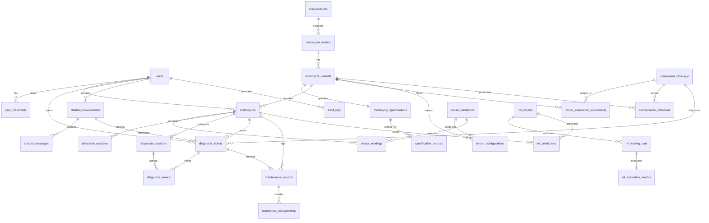

# POCKET MECHANIC — Database Schema & Entity Relationship Diagram
### Offline MySQL 9.5 Community Server Relational Schema

---

## 1. Normalized Entity Overview (28 Entities)

The Pocket Mechanic database (`pocket_mechanic_db`) is normalized across 28 distinct relational entities:

| Category | Entity Name | Primary Key | Description |
| :--- | :--- | :--- | :--- |
| **User & Security** | `users` | `user_id` | Core rider profiles with encrypted driving licence |
| | `user_credentials` | `credential_id` | Secure salted password hashes and last login timestamps |
| | `audit_logs` | `log_id` | Security audit trail of all sensitive operations |
| **Motorcycle Master** | `manufacturers` | `manufacturer_id` | 28 Verified OEMs with origin country and founded year |
| | `motorcycle_models` | `model_id` | Model catalogue with category and silhouette codes |
| | `motorcycle_variants` | `variant_id` | Engine, cooling, brake, and drive architectural types |
| | `motorcycle_specifications` | `spec_id` | Comprehensive 50+ parameter technical specifications |
| | `specification_sources` | `source_id` | Verification sources (Owner/Workshop Manuals, URLs) |
| | `motorcycles` | `motorcycle_id` | User registered motorcycles with custom make/model support |
| **Applicability & Service** | `component_catalogue` | `component_id` | Master list of all motorcycle components across 3 groups |
| | `model_component_applicability` | `applicability_id` | Dynamic architectural rules per variant |
| | `maintenance_schedules` | `schedule_id` | OEM inspection intervals (km and days) |
| **Telemetry & Sensors** | `sensor_definitions` | `sensor_id` | Sensor parameters, physical units, and tolerance bounds |
| | `sensor_configurations` | `config_id` | Installed & simulated sensor mapping per variant |
| | `sensor_readings` | `reading_id` | Time-series telemetry records with `source_type` tag |
| | `simulation_sessions` | `session_id` | Telemetry simulation sessions with intensity profiles |
| **Diagnostics & ML** | `diagnostic_sessions` | `session_id` | Diagnostic sessions initiated by user or telemetry alerts |
| | `diagnostic_tickets` | `ticket_id` | Issue lifecycle tracking (Open, Investigating, Resolved, Reopened) |
| | `diagnostic_results` | `result_id` | Inference outputs, probabilities, and live ML traces |
| | `ml_models` | `model_id` | Classical ML models registry with version tracking |
| | `ml_training_runs` | `run_id` | Hyperparameters, sample counts, and durations |
| | `ml_predictions` | `prediction_id` | Historic ML prediction logs with feature vectors |
| | `ml_evaluation_metrics` | `metric_id` | Accuracy, Precision, Recall, F1, ROC-AUC, MAE, RMSE, R² |
| **Maintenance Logbook** | `maintenance_records` | `record_id` | Service logs, oil changes, repair centers, and costs |
| | `component_replacements` | `replacement_id` | Replaced parts with warranties and odometer stamps |
| **Wrenchy Assistant** | `chatbot_conversations` | `conversation_id` | Chat session headers linked to user & motorcycle |
| | `chatbot_messages` | `message_id` | Chronological messages with sender and payloads |
| **Configuration** | `application_settings` | `setting_id` | Developer toolbar toggles, modes, and active theme |

---

## 2. Mermaid Entity Relationship Diagram

